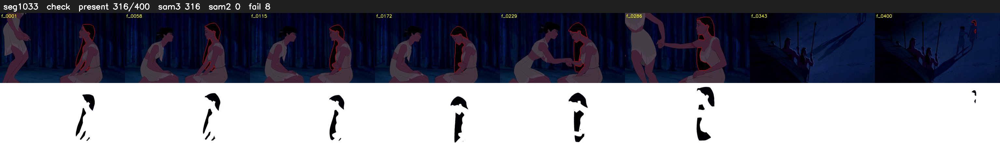

# Segment 1033 (shot)

Film frames 88636-89035 (400 frames, 62:36.9-62:53.5).

**Status: check**

| | |
|---|---|
| Frames with her hair | 316 / 400 |
| Mask source | SAM3 316, SAM2 fallback 0 |
| Frames still failing QC | 8 [304, 384, 386, 387, 389, 390, 391, 395] |
| Film indices with no picture (held) | 0 |
| Time | 833 s |

Top: source with the final mask outlined in red. Bottom: white-fill output.

## Issues

- dark scene: 94% of frames fail 'missed', missed QC off
- other characters' hair erased on 373 frames
