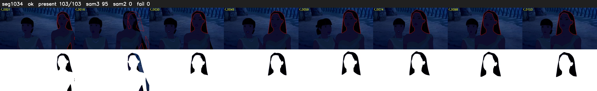

# Segment 1034 (shot)

Film frames 89036-89138 (103 frames, 62:53.5-62:57.8).

**Status: ok**

| | |
|---|---|
| Frames with her hair | 103 / 103 |
| Mask source | SAM3 95, SAM2 fallback 0 |
| Frames still failing QC | 0 [] |
| Film indices with no picture (held) | 0 |
| Time | 215 s |

Top: source with the final mask outlined in red. Bottom: white-fill output.

## Issues

- manual override: step 18 gaps: Pocahontas stands still beside Nakoma at night, SAM3 drops her hair on f11-22
- hold_gaps: 8 dropout frames hold the previous mask
- other characters' hair erased on 103 frames
