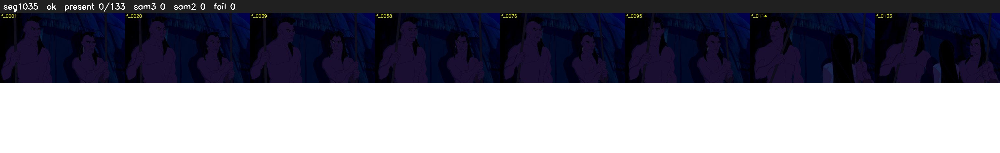

# Segment 1035 (shot)

Film frames 89139-89271 (133 frames, 62:57.8-62:03.4).

**Status: ok**

| | |
|---|---|
| Frames with her hair | 0 / 133 |
| Mask source | SAM3 0, SAM2 fallback 0 |
| Frames still failing QC | 0 [] |
| Film indices with no picture (held) | 0 |
| Time | 321 s |

Top: source with the final mask outlined in red. Bottom: white-fill output.

## Issues

- other characters' hair erased on 133 frames
