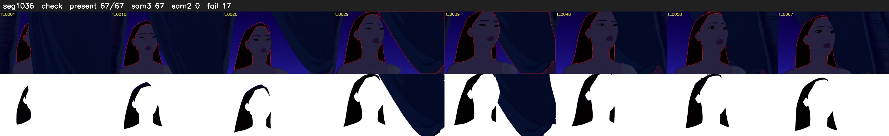

# Segment 1036 (shot)

Film frames 89272-89338 (67 frames, 62:03.4-62:06.2).

**Status: check**

| | |
|---|---|
| Frames with her hair | 67 / 67 |
| Mask source | SAM3 67, SAM2 fallback 0 |
| Frames still failing QC | 17 [17, 18, 19, 28, 29, 30, 31, 32, 33, 34, 35, 36, 37, 38, 39, 45, 46] |
| Film indices with no picture (held) | 0 |
| Time | 113 s |

Top: source with the final mask outlined in red. Bottom: white-fill output.
