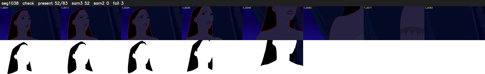

# Segment 1038 (shot)

Film frames 89410-89492 (83 frames, 62:09.1-62:12.6).

**Status: check**

| | |
|---|---|
| Frames with her hair | 52 / 83 |
| Mask source | SAM3 52, SAM2 fallback 0 |
| Frames still failing QC | 3 [47, 49, 52] |
| Film indices with no picture (held) | 0 |
| Time | 145 s |

Top: source with the final mask outlined in red. Bottom: white-fill output.

## Issues

- other characters' hair erased on 33 frames
