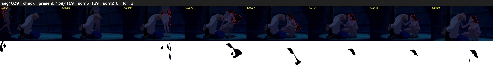

# Segment 1039 (shot)

Film frames 89493-89661 (169 frames, 62:12.6-62:19.7).

**Status: check**

| | |
|---|---|
| Frames with her hair | 139 / 169 |
| Mask source | SAM3 139, SAM2 fallback 0 |
| Frames still failing QC | 2 [12, 43] |
| Film indices with no picture (held) | 0 |
| Time | 283 s |

Top: source with the final mask outlined in red. Bottom: white-fill output.

## Issues

- other characters' hair erased on 30 frames
