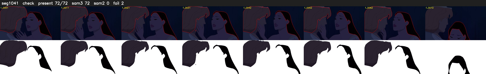

# Segment 1041 (shot)

Film frames 89726-89797 (72 frames, 62:22.3-62:25.3).

**Status: check**

| | |
|---|---|
| Frames with her hair | 72 / 72 |
| Mask source | SAM3 72, SAM2 fallback 0 |
| Frames still failing QC | 2 [68, 69] |
| Film indices with no picture (held) | 0 |
| Time | 142 s |

Top: source with the final mask outlined in red. Bottom: white-fill output.

## Issues

- tinted scene: median hair purity 0.35 < 0.5, purity/missed QC off
