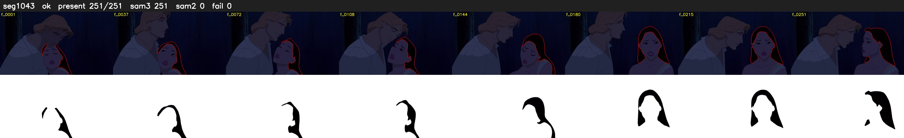

# Segment 1043 (shot)

Film frames 89868-90118 (251 frames, 62:28.2-63:38.7).

**Status: ok**

| | |
|---|---|
| Frames with her hair | 251 / 251 |
| Mask source | SAM3 251, SAM2 fallback 0 |
| Frames still failing QC | 0 [] |
| Film indices with no picture (held) | 0 |
| Time | 366 s |

Top: source with the final mask outlined in red. Bottom: white-fill output.

## Issues

- dark scene: 100% of frames fail 'missed', missed QC off
