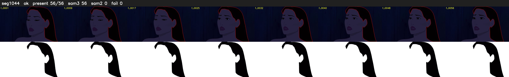

# Segment 1044 (shot)

Film frames 90119-90174 (56 frames, 63:38.7-63:41.0).

**Status: ok**

| | |
|---|---|
| Frames with her hair | 56 / 56 |
| Mask source | SAM3 56, SAM2 fallback 0 |
| Frames still failing QC | 0 [] |
| Film indices with no picture (held) | 0 |
| Time | 82 s |

Top: source with the final mask outlined in red. Bottom: white-fill output.
