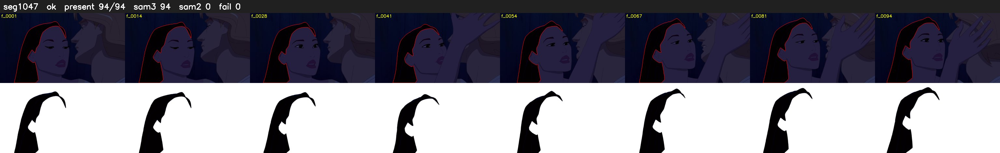

# Segment 1047 (shot)

Film frames 90304-90397 (94 frames, 63:46.4-63:50.3).

**Status: ok**

| | |
|---|---|
| Frames with her hair | 94 / 94 |
| Mask source | SAM3 94, SAM2 fallback 0 |
| Frames still failing QC | 0 [] |
| Film indices with no picture (held) | 0 |
| Time | 137 s |

Top: source with the final mask outlined in red. Bottom: white-fill output.
