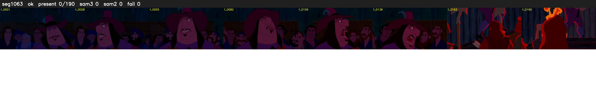

# Segment 1063 (shot)

Film frames 91731-91920 (190 frames, 64:45.9-64:53.9).

**Status: ok**

| | |
|---|---|
| Frames with her hair | 0 / 190 |
| Mask source | SAM3 0, SAM2 fallback 0 |
| Frames still failing QC | 0 [] |
| Film indices with no picture (held) | 0 |
| Time | 437 s |

Top: source with the final mask outlined in red. Bottom: white-fill output.

## Issues

- other characters' hair erased on 190 frames
