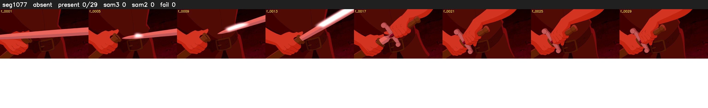

# Segment 1077 (shot)

Film frames 92566-92594 (29 frames, 64:20.8-64:22.0).

**Status: absent**

| | |
|---|---|
| Frames with her hair | 0 / 29 |
| Mask source | SAM3 0, SAM2 fallback 0 |
| Frames still failing QC | 0 [] |
| Film indices with no picture (held) | 0 |
| Time | 9 s |

Top: source with the final mask outlined in red. Bottom: white-fill output.

## Issues

- hair on 4/5 presence frames, none of it hers (best P 0.07)
