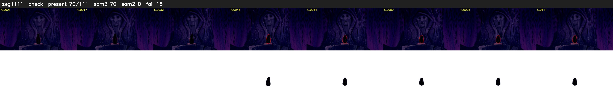

# Segment 1111 (shot)

Film frames 94263-94373 (111 frames, 66:31.6-66:36.2).

**Status: check**

| | |
|---|---|
| Frames with her hair | 70 / 111 |
| Mask source | SAM3 70, SAM2 fallback 0 |
| Frames still failing QC | 16 [42, 43, 44, 50, 51, 53, 54, 55, 56, 57, 58, 59, 60, 61, 62, 63] |
| Film indices with no picture (held) | 0 |
| Time | 176 s |

Top: source with the final mask outlined in red. Bottom: white-fill output.

## Issues

- other characters' hair erased on 41 frames
