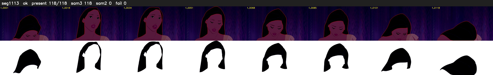

# Segment 1113 (shot)

Film frames 94462-94579 (118 frames, 66:39.9-66:44.8).

**Status: ok**

| | |
|---|---|
| Frames with her hair | 118 / 118 |
| Mask source | SAM3 118, SAM2 fallback 0 |
| Frames still failing QC | 0 [] |
| Film indices with no picture (held) | 0 |
| Time | 175 s |

Top: source with the final mask outlined in red. Bottom: white-fill output.
