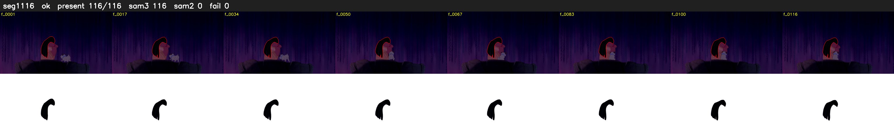

# Segment 1116 (shot)

Film frames 94728-94843 (116 frames, 66:50.9-66:55.8).

**Status: ok**

| | |
|---|---|
| Frames with her hair | 116 / 116 |
| Mask source | SAM3 116, SAM2 fallback 0 |
| Frames still failing QC | 0 [] |
| Film indices with no picture (held) | 0 |
| Time | 169 s |

Top: source with the final mask outlined in red. Bottom: white-fill output.
