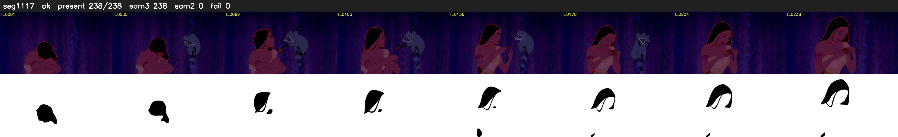

# Segment 1117 (shot)

Film frames 94844-95081 (238 frames, 66:55.8-66:05.7).

**Status: ok**

| | |
|---|---|
| Frames with her hair | 238 / 238 |
| Mask source | SAM3 238, SAM2 fallback 0 |
| Frames still failing QC | 0 [] |
| Film indices with no picture (held) | 0 |
| Time | 407 s |

Top: source with the final mask outlined in red. Bottom: white-fill output.
