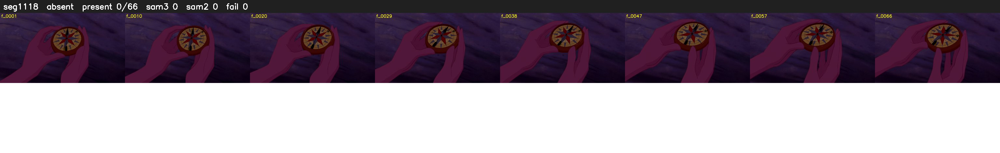

# Segment 1118 (shot)

Film frames 95082-95147 (66 frames, 66:05.7-66:08.5).

**Status: absent**

| | |
|---|---|
| Frames with her hair | 0 / 66 |
| Mask source | SAM3 0, SAM2 fallback 0 |
| Frames still failing QC | 0 [] |
| Film indices with no picture (held) | 0 |
| Time | 17 s |

Top: source with the final mask outlined in red. Bottom: white-fill output.
