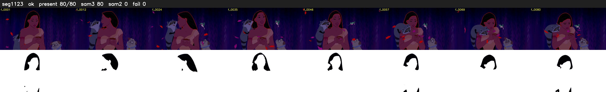

# Segment 1123 (shot)

Film frames 95372-95451 (80 frames, 66:17.8-66:21.1).

**Status: ok**

| | |
|---|---|
| Frames with her hair | 80 / 80 |
| Mask source | SAM3 80, SAM2 fallback 0 |
| Frames still failing QC | 0 [] |
| Film indices with no picture (held) | 0 |
| Time | 131 s |

Top: source with the final mask outlined in red. Bottom: white-fill output.

## Issues

- dark scene: 66% of frames fail 'missed', missed QC off
