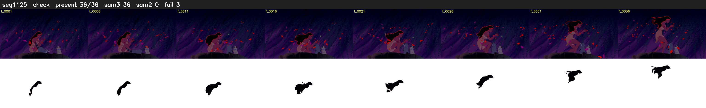

# Segment 1125 (shot)

Film frames 95516-95551 (36 frames, 66:23.8-66:25.3).

**Status: check**

| | |
|---|---|
| Frames with her hair | 36 / 36 |
| Mask source | SAM3 36, SAM2 fallback 0 |
| Frames still failing QC | 3 [34, 35, 36] |
| Film indices with no picture (held) | 0 |
| Time | 56 s |

Top: source with the final mask outlined in red. Bottom: white-fill output.
