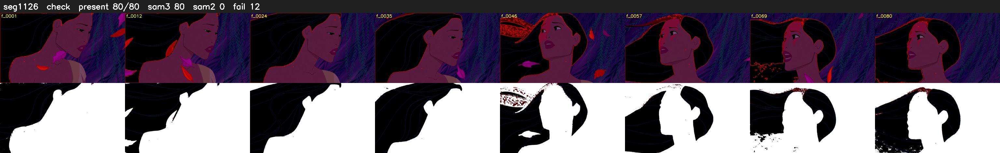

# Segment 1126 (shot)

Film frames 95552-95631 (80 frames, 66:25.3-66:28.7).

**Status: check**

| | |
|---|---|
| Frames with her hair | 80 / 80 |
| Mask source | SAM3 80, SAM2 fallback 0 |
| Frames still failing QC | 12 [14, 61, 62, 63, 65, 66, 67, 68, 69, 70, 71, 72] |
| Film indices with no picture (held) | 0 |
| Time | 133 s |

Top: source with the final mask outlined in red. Bottom: white-fill output.
