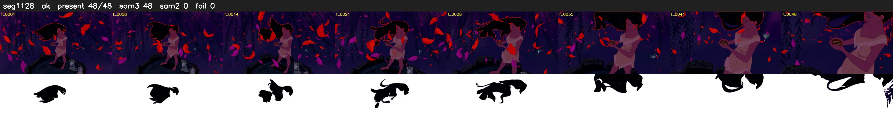

# Segment 1128 (shot)

Film frames 95722-95769 (48 frames, 67:32.4-67:34.4).

**Status: ok**

| | |
|---|---|
| Frames with her hair | 48 / 48 |
| Mask source | SAM3 48, SAM2 fallback 0 |
| Frames still failing QC | 0 [] |
| Film indices with no picture (held) | 0 |
| Time | 74 s |

Top: source with the final mask outlined in red. Bottom: white-fill output.
