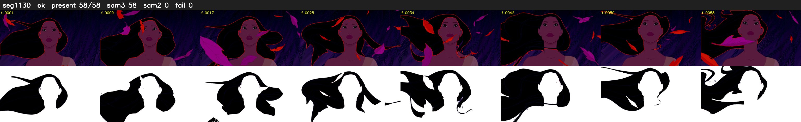

# Segment 1130 (shot)

Film frames 95855-95912 (58 frames, 67:38.0-67:40.4).

**Status: ok**

| | |
|---|---|
| Frames with her hair | 58 / 58 |
| Mask source | SAM3 58, SAM2 fallback 0 |
| Frames still failing QC | 0 [] |
| Film indices with no picture (held) | 0 |
| Time | 88 s |

Top: source with the final mask outlined in red. Bottom: white-fill output.

## Issues

- dark scene: 100% of frames fail 'missed', missed QC off
