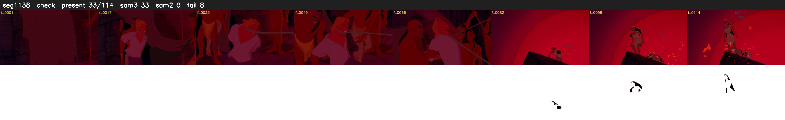

# Segment 1138 (shot)

Film frames 96195-96308 (114 frames, 67:52.1-67:56.9).

**Status: check**

| | |
|---|---|
| Frames with her hair | 33 / 114 |
| Mask source | SAM3 33, SAM2 fallback 0 |
| Frames still failing QC | 8 [82, 83, 84, 85, 86, 87, 92, 93] |
| Film indices with no picture (held) | 0 |
| Time | 258 s |

Top: source with the final mask outlined in red. Bottom: white-fill output.

## Issues

- other characters' hair erased on 77 frames
