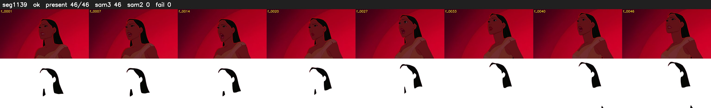

# Segment 1139 (shot)

Film frames 96309-96354 (46 frames, 67:56.9-67:58.8).

**Status: ok**

| | |
|---|---|
| Frames with her hair | 46 / 46 |
| Mask source | SAM3 46, SAM2 fallback 0 |
| Frames still failing QC | 0 [] |
| Film indices with no picture (held) | 0 |
| Time | 77 s |

Top: source with the final mask outlined in red. Bottom: white-fill output.
