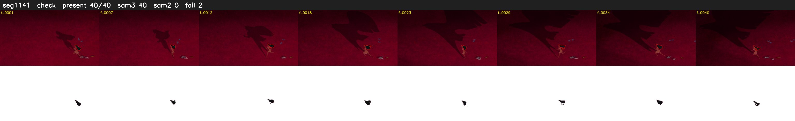

# Segment 1141 (shot)

Film frames 96396-96435 (40 frames, 67:00.5-67:02.2).

**Status: check**

| | |
|---|---|
| Frames with her hair | 40 / 40 |
| Mask source | SAM3 40, SAM2 fallback 0 |
| Frames still failing QC | 2 [1, 3] |
| Film indices with no picture (held) | 0 |
| Time | 61 s |

Top: source with the final mask outlined in red. Bottom: white-fill output.

## Issues

- fallback 1-1: no seed prompts (cleaned seed too small (4681 px): hair lost)
- fallback 3-3: no seed prompts (cleaned seed too small (4681 px): hair lost)
