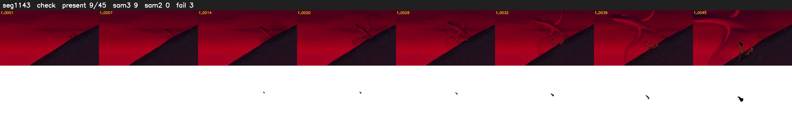

# Segment 1143 (shot)

Film frames 96474-96518 (45 frames, 67:03.8-67:05.6).

**Status: check**

| | |
|---|---|
| Frames with her hair | 9 / 45 |
| Mask source | SAM3 9, SAM2 fallback 0 |
| Frames still failing QC | 3 [38, 39, 40] |
| Film indices with no picture (held) | 0 |
| Time | 69 s |

Top: source with the final mask outlined in red. Bottom: white-fill output.

## Issues

- fallback 38-40: no seed prompts (cleaned seed too small (1461 px): hair lost)
