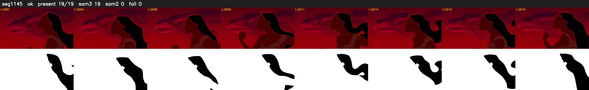

# Segment 1145 (shot)

Film frames 96556-96574 (19 frames, 67:07.2-67:08.0).

**Status: ok**

| | |
|---|---|
| Frames with her hair | 19 / 19 |
| Mask source | SAM3 19, SAM2 fallback 0 |
| Frames still failing QC | 0 [] |
| Film indices with no picture (held) | 0 |
| Time | 31 s |

Top: source with the final mask outlined in red. Bottom: white-fill output.
