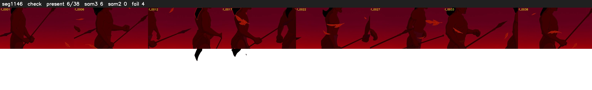

# Segment 1146 (shot)

Film frames 96575-96612 (38 frames, 67:08.0-67:09.6).

**Status: check**

| | |
|---|---|
| Frames with her hair | 6 / 38 |
| Mask source | SAM3 6, SAM2 fallback 0 |
| Frames still failing QC | 4 [13, 14, 15, 20] |
| Film indices with no picture (held) | 0 |
| Time | 61 s |

Top: source with the final mask outlined in red. Bottom: white-fill output.

## Issues

- other characters' hair erased on 36 frames
