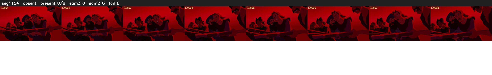

# Segment 1154 (shot)

Film frames 96803-96810 (8 frames, 67:17.5-67:17.8).

**Status: absent**

| | |
|---|---|
| Frames with her hair | 0 / 8 |
| Mask source | SAM3 0, SAM2 fallback 0 |
| Frames still failing QC | 0 [] |
| Film indices with no picture (held) | 0 |
| Time | 6 s |

Top: source with the final mask outlined in red. Bottom: white-fill output.

## Issues

- hair on 2/2 presence frames, none of it hers (best P 0.01)
