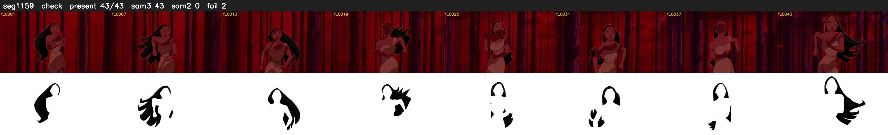

# Segment 1159 (shot)

Film frames 96992-97034 (43 frames, 67:25.4-67:27.2).

**Status: check**

| | |
|---|---|
| Frames with her hair | 43 / 43 |
| Mask source | SAM3 43, SAM2 fallback 0 |
| Frames still failing QC | 2 [9, 10] |
| Film indices with no picture (held) | 0 |
| Time | 68 s |

Top: source with the final mask outlined in red. Bottom: white-fill output.
