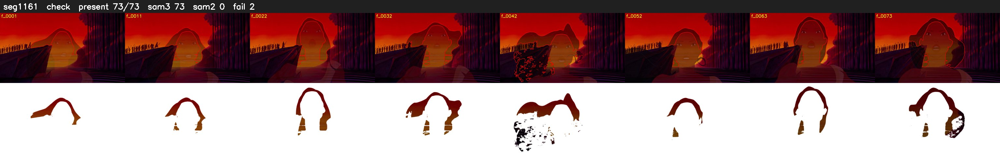

# Segment 1161 (shot)

Film frames 97055-97127 (73 frames, 67:28.0-68:31.0).

**Status: check**

| | |
|---|---|
| Frames with her hair | 73 / 73 |
| Mask source | SAM3 73, SAM2 fallback 0 |
| Frames still failing QC | 2 [38, 41] |
| Film indices with no picture (held) | 0 |
| Time | 137 s |

Top: source with the final mask outlined in red. Bottom: white-fill output.

## Issues

- tinted scene: median hair purity 0.00 < 0.5, purity/missed QC off
- fallback 38-38: no seed prompts (cleaned seed too small (0 px): hair lost)
- fallback 41-41: no seed prompts (cleaned seed too small (0 px): hair lost)
- other characters' hair erased on 2 frames
