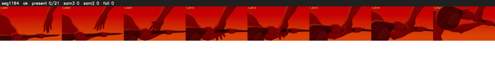

# Segment 1164 (shot)

Film frames 97190-97210 (21 frames, 68:33.6-68:34.5).

**Status: ok**

| | |
|---|---|
| Frames with her hair | 0 / 21 |
| Mask source | SAM3 0, SAM2 fallback 0 |
| Frames still failing QC | 0 [] |
| Film indices with no picture (held) | 0 |
| Time | 40 s |

Top: source with the final mask outlined in red. Bottom: white-fill output.

## Issues

- other characters' hair erased on 19 frames
