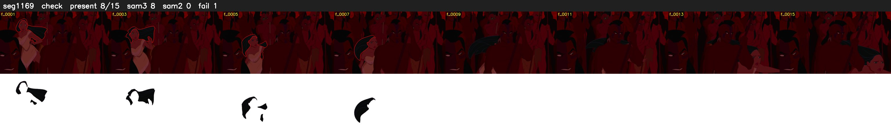

# Segment 1169 (shot)

Film frames 97291-97305 (15 frames, 68:37.8-68:38.5).

**Status: check**

| | |
|---|---|
| Frames with her hair | 8 / 15 |
| Mask source | SAM3 8, SAM2 fallback 0 |
| Frames still failing QC | 1 [8] |
| Film indices with no picture (held) | 0 |
| Time | 57 s |

Top: source with the final mask outlined in red. Bottom: white-fill output.

## Issues

- dark scene: 100% of frames fail 'missed', missed QC off
- other characters' hair erased on 15 frames
