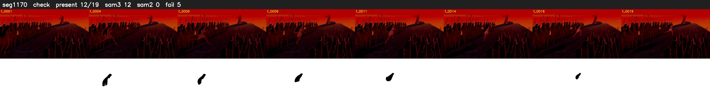

# Segment 1170 (shot)

Film frames 97306-97324 (19 frames, 68:38.5-68:39.3).

**Status: check**

| | |
|---|---|
| Frames with her hair | 12 / 19 |
| Mask source | SAM3 12, SAM2 fallback 0 |
| Frames still failing QC | 5 [10, 11, 13, 14, 15] |
| Film indices with no picture (held) | 0 |
| Time | 74 s |

Top: source with the final mask outlined in red. Bottom: white-fill output.

## Issues

- other characters' hair erased on 19 frames
