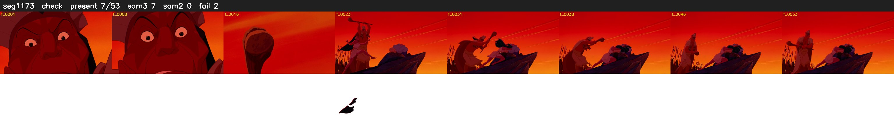

# Segment 1173 (shot)

Film frames 97345-97397 (53 frames, 68:40.1-68:42.3).

**Status: check**

| | |
|---|---|
| Frames with her hair | 7 / 53 |
| Mask source | SAM3 7, SAM2 fallback 0 |
| Frames still failing QC | 2 [20, 26] |
| Film indices with no picture (held) | 0 |
| Time | 107 s |

Top: source with the final mask outlined in red. Bottom: white-fill output.

## Issues

- other characters' hair erased on 47 frames
