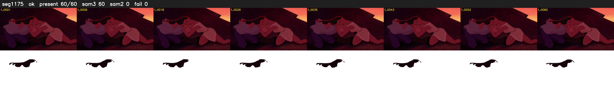

# Segment 1175 (shot)

Film frames 97430-97489 (60 frames, 68:43.6-68:46.1).

**Status: ok**

| | |
|---|---|
| Frames with her hair | 60 / 60 |
| Mask source | SAM3 60, SAM2 fallback 0 |
| Frames still failing QC | 0 [] |
| Film indices with no picture (held) | 0 |
| Time | 92 s |

Top: source with the final mask outlined in red. Bottom: white-fill output.
