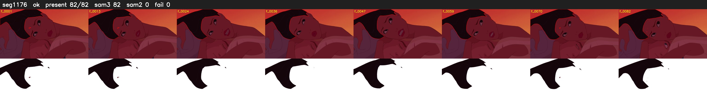

# Segment 1176 (shot)

Film frames 97490-97571 (82 frames, 68:46.1-68:49.6).

**Status: ok**

| | |
|---|---|
| Frames with her hair | 82 / 82 |
| Mask source | SAM3 82, SAM2 fallback 0 |
| Frames still failing QC | 0 [] |
| Film indices with no picture (held) | 0 |
| Time | 120 s |

Top: source with the final mask outlined in red. Bottom: white-fill output.
