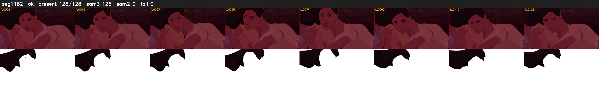

# Segment 1182 (shot)

Film frames 97866-97993 (128 frames, 68:01.8-68:07.2).

**Status: ok**

| | |
|---|---|
| Frames with her hair | 128 / 128 |
| Mask source | SAM3 128, SAM2 fallback 0 |
| Frames still failing QC | 0 [] |
| Film indices with no picture (held) | 0 |
| Time | 190 s |

Top: source with the final mask outlined in red. Bottom: white-fill output.
