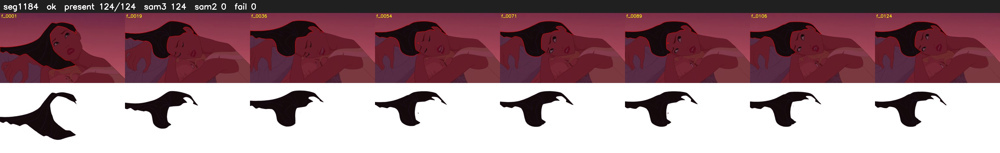

# Segment 1184 (shot)

Film frames 98028-98151 (124 frames, 68:08.6-68:13.8).

**Status: ok**

| | |
|---|---|
| Frames with her hair | 124 / 124 |
| Mask source | SAM3 124, SAM2 fallback 0 |
| Frames still failing QC | 0 [] |
| Film indices with no picture (held) | 0 |
| Time | 182 s |

Top: source with the final mask outlined in red. Bottom: white-fill output.
