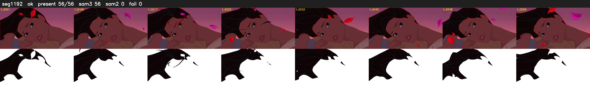

# Segment 1192 (shot)

Film frames 98540-98595 (56 frames, 68:29.9-69:32.3).

**Status: ok**

| | |
|---|---|
| Frames with her hair | 56 / 56 |
| Mask source | SAM3 56, SAM2 fallback 0 |
| Frames still failing QC | 0 [] |
| Film indices with no picture (held) | 0 |
| Time | 84 s |

Top: source with the final mask outlined in red. Bottom: white-fill output.
