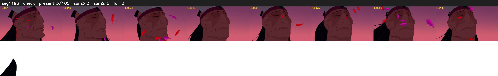

# Segment 1193 (shot)

Film frames 98596-98700 (105 frames, 69:32.3-69:36.7).

**Status: check**

| | |
|---|---|
| Frames with her hair | 3 / 105 |
| Mask source | SAM3 3, SAM2 fallback 0 |
| Frames still failing QC | 3 [1, 3, 4] |
| Film indices with no picture (held) | 0 |
| Time | 240 s |

Top: source with the final mask outlined in red. Bottom: white-fill output.

## Issues

- other characters' hair erased on 105 frames
