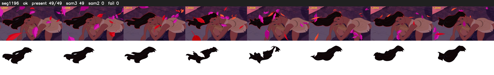

# Segment 1196 (shot)

Film frames 98930-98978 (49 frames, 69:46.2-69:48.2).

**Status: ok**

| | |
|---|---|
| Frames with her hair | 49 / 49 |
| Mask source | SAM3 49, SAM2 fallback 0 |
| Frames still failing QC | 0 [] |
| Film indices with no picture (held) | 0 |
| Time | 77 s |

Top: source with the final mask outlined in red. Bottom: white-fill output.
