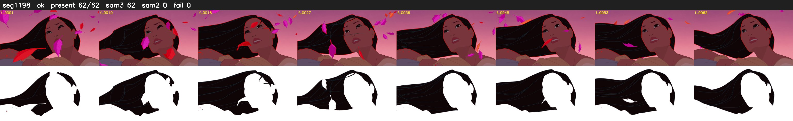

# Segment 1198 (shot)

Film frames 99237-99298 (62 frames, 69:59.0-69:01.6).

**Status: ok**

| | |
|---|---|
| Frames with her hair | 62 / 62 |
| Mask source | SAM3 62, SAM2 fallback 0 |
| Frames still failing QC | 0 [] |
| Film indices with no picture (held) | 0 |
| Time | 92 s |

Top: source with the final mask outlined in red. Bottom: white-fill output.
