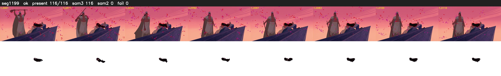

# Segment 1199 (shot)

Film frames 99299-99414 (116 frames, 69:01.6-69:06.4).

**Status: ok**

| | |
|---|---|
| Frames with her hair | 116 / 116 |
| Mask source | SAM3 116, SAM2 fallback 0 |
| Frames still failing QC | 0 [] |
| Film indices with no picture (held) | 0 |
| Time | 292 s |

Top: source with the final mask outlined in red. Bottom: white-fill output.

## Issues

- other characters' hair erased on 10 frames
