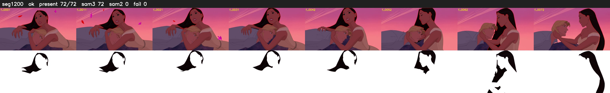

# Segment 1200 (shot)

Film frames 99415-99486 (72 frames, 69:06.4-69:09.4).

**Status: ok**

| | |
|---|---|
| Frames with her hair | 72 / 72 |
| Mask source | SAM3 72, SAM2 fallback 0 |
| Frames still failing QC | 0 [] |
| Film indices with no picture (held) | 0 |
| Time | 109 s |

Top: source with the final mask outlined in red. Bottom: white-fill output.
