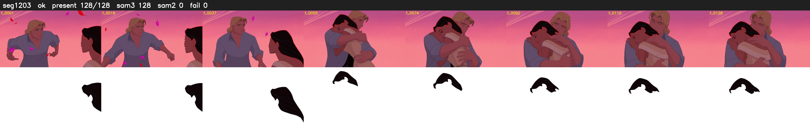

# Segment 1203 (shot)

Film frames 99574-99701 (128 frames, 69:13.1-69:18.4).

**Status: ok**

| | |
|---|---|
| Frames with her hair | 128 / 128 |
| Mask source | SAM3 128, SAM2 fallback 0 |
| Frames still failing QC | 0 [] |
| Film indices with no picture (held) | 0 |
| Time | 191 s |

Top: source with the final mask outlined in red. Bottom: white-fill output.
