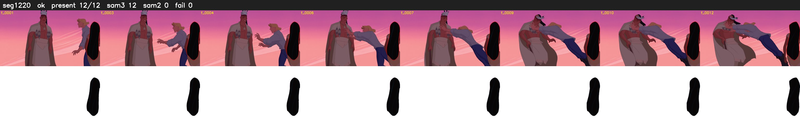

# Segment 1220 (shot)

Film frames 100420-100431 (12 frames, 70:48.4-70:48.9).

**Status: ok**

| | |
|---|---|
| Frames with her hair | 12 / 12 |
| Mask source | SAM3 12, SAM2 fallback 0 |
| Frames still failing QC | 0 [] |
| Film indices with no picture (held) | 0 |
| Time | 29 s |

Top: source with the final mask outlined in red. Bottom: white-fill output.

## Issues

- other characters' hair erased on 8 frames
