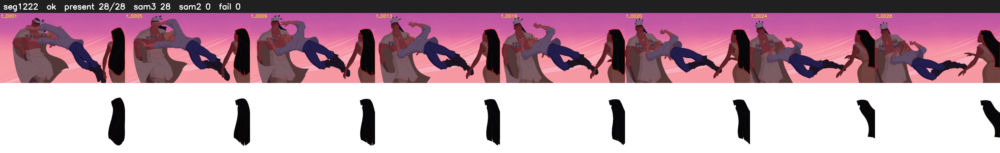

# Segment 1222 (shot)

Film frames 100451-100478 (28 frames, 70:49.6-70:50.8).

**Status: ok**

| | |
|---|---|
| Frames with her hair | 28 / 28 |
| Mask source | SAM3 28, SAM2 fallback 0 |
| Frames still failing QC | 0 [] |
| Film indices with no picture (held) | 0 |
| Time | 57 s |

Top: source with the final mask outlined in red. Bottom: white-fill output.

## Issues

- other characters' hair erased on 22 frames
