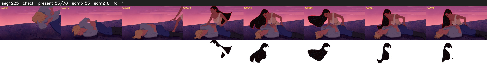

# Segment 1225 (shot)

Film frames 100537-100614 (78 frames, 70:53.2-70:56.5).

**Status: check**

| | |
|---|---|
| Frames with her hair | 53 / 78 |
| Mask source | SAM3 53, SAM2 fallback 0 |
| Frames still failing QC | 1 [26] |
| Film indices with no picture (held) | 0 |
| Time | 121 s |

Top: source with the final mask outlined in red. Bottom: white-fill output.

## Issues

- other characters' hair erased on 25 frames
