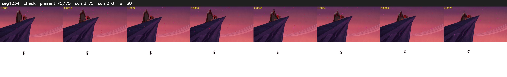

# Segment 1234 (shot)

Film frames 101130-101204 (75 frames, 70:18.0-70:21.1).

**Status: check**

| | |
|---|---|
| Frames with her hair | 75 / 75 |
| Mask source | SAM3 75, SAM2 fallback 0 |
| Frames still failing QC | 30 [29, 45, 47, 48, 49, 50, 51, 52, 53, 54, 55, 56, 57, 58, 59, 60, 61, 62, 63, 64] |
| Film indices with no picture (held) | 0 |
| Time | 141 s |

Top: source with the final mask outlined in red. Bottom: white-fill output.

## Issues

- fallback 29-29: no seed prompts (cleaned seed too small (2710 px): hair lost)
- fallback 45-45: no seed prompts (cleaned seed too small (2179 px): hair lost)
- fallback 47-71: no seed prompts (cleaned seed too small (1887 px): hair lost)
- fallback 73-75: no seed prompts (cleaned seed too small (1715 px): hair lost)
